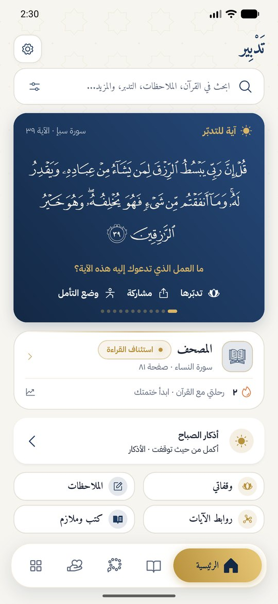
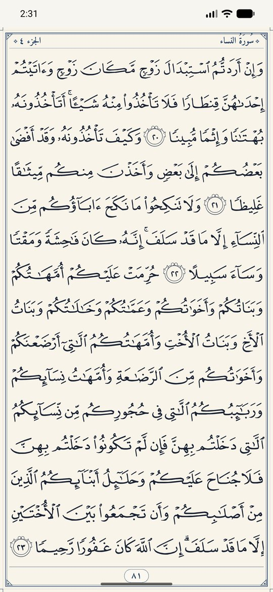
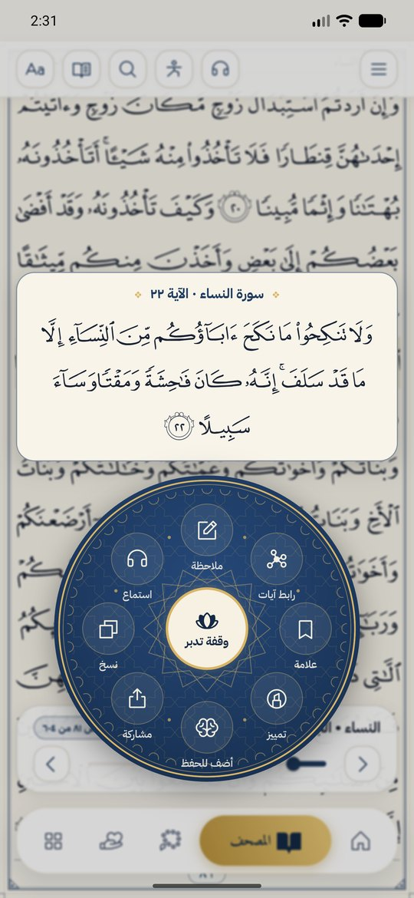
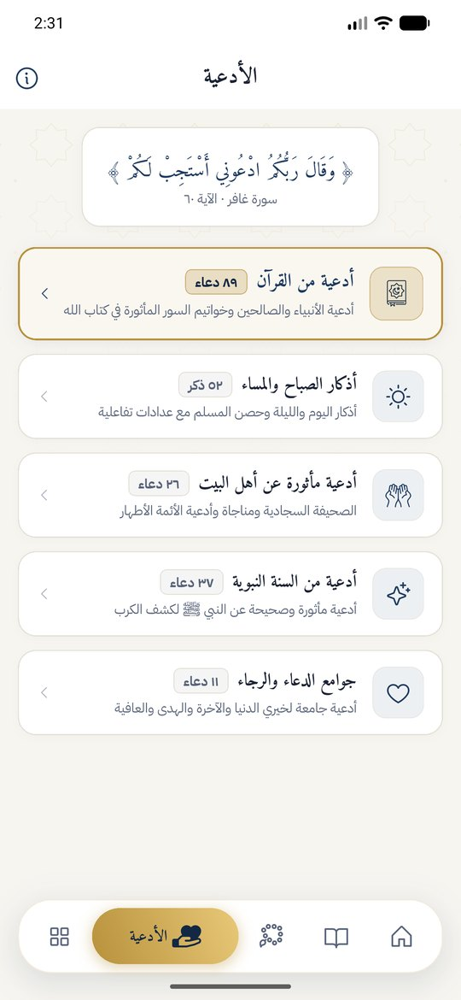

<div align="center">


# تَدْبِير

**من القراءة إلى التدبّر.** تطبيق قرآني مفتوح المصدر يعمل دون إنترنت، بلا إعلانات ولا تتبع.

[](https://github.com/Abdullah1x2x/Tadbeer/actions/workflows/ci.yml)
[](https://flutter.dev)
[](LICENSE)

[تحميل التطبيق](https://github.com/Abdullah1x2x/Tadbeer/releases) · [الموقع](https://abdullah-alshami.github.io/Tadbeer/) · [دليل المشروع](docs/PROJECT_GUIDE.md) · [English](README.md)

</div>

<p align="center">
  
  
  
  
</p>

## لماذا تدبير؟

هدف التطبيق أن يساعدك على فهم القرآن والعمل به، لا على القراءة فقط. لذلك بُني حول ثلاث أدوات:

- **وقفة التدبر:** أربعة أسئلة عند كل آية تفتح لك معانيها.
- **روابط الآيات:** اجمع آيات من سور متفرقة في موضوع واحد، وانظر إليها كشبكة.
- **مسارات التدبر:** 15 موضوعاً، آية وسؤال كل يوم لسبعة أيام على الأقل.

## المميزات

| القسم | ما يقدمه |
| --- | --- |
| **المصحف** | 604 صفحات بخطوط مصحف المدينة أو بخطوط نصية، وتقليب سلس، وقائمة دائرية للآية، ومعاني الكلمات |
| **الاستماع** | 7 قرّاء، سورة أو آية واحدة، وتنزيل للاستماع دون إنترنت |
| **رحلتي** | ختمة بخطة، وسلسلة أيام، وأهداف، وخريطة للمصحف، وتقرير شهري |
| **الحفظ** | مراجعة متباعدة للآيات التي تحفظها |
| **الأدعية** | أدعية القرآن والسنة وأهل البيت، وأذكار يومية بعدّاد |
| **الذكر** | سبحة للاستغفار والتسبيح مع عد تلقائي |
| **الملاحظات** | ملاحظات على الآيات ودفتر تدبر، مع التصدير والحفظ في الجهاز |
| **المكتبة** | كتب وملازم تُقرأ داخل التطبيق |
| **المزيد** | بحث موحد، واتجاه القبلة، وتذكيرات، وودجت للهاتف، ونسخ احتياطي مشفر |

والتطبيق يشرح نفسه: جولة عند أول تشغيل، وشرح متحرك لكل قسم، ودليل يعرّفك بالشاشة الرئيسية.

## الخصوصية

كل بياناتك تبقى على جهازك. لا حساب ولا إعلانات ولا تحليلات. والإنترنت يُستخدم للتلاوة فقط، والموقع التقريبي للقبلة فقط. التفاصيل في [سياسة الخصوصية](PRIVACY_POLICY.md).

## التشغيل

تحتاج Flutter 3.47.6 وAndroid SDK. والخطوات الكاملة من الصفر في [دليل المشروع](docs/PROJECT_GUIDE.md#2-تجهيز-جهازك-من-الصفر).

```bash
git clone https://github.com/Abdullah1x2x/Tadbeer.git
```

```bash
cd Tadbeer && flutter pub get && flutter run
```

```bash
flutter analyze && flutter test
```

## التوثيق

| الملف | لمن |
| --- | --- |
| [دليل المشروع](docs/PROJECT_GUIDE.md) | ابدأ من هنا: كل الملفات، وكيف تعدّل أي تفصيلة |
| [دليل التطوير](DEVELOPMENT_GUIDE.ar.md) | ملخص الأنظمة ومعايير الكود |
| [دليل المعمارية](docs/ARCHITECTURE_AND_CODE_GUIDE.md) | شرح أعمق لأهم الأنظمة |
| [دليل المحتوى](docs/CONTENT_GUIDE.md) | إضافة الأدعية والكتب والمسارات |
| [سجل التغييرات](CHANGELOG.md) | ما تغيّر في كل إصدار |

## المساهمة

نرحب بالتصحيحات والاقتراحات عبر [Issues](https://github.com/Abdullah1x2x/Tadbeer/issues) وطلبات الدمج. وإذا وجدت خطأً في نص ديني فأبلغنا به أولاً.

## الرخصة والمصادر

كود التطبيق برخصة [MIT](LICENSE). أما المحتوى المضمّن فله مصادره وشروطه:

- نص القرآن: [مشروع تنزيل](https://tanzil.net).
- خطوط المصحف: مجمع الملك فهد لطباعة المصحف الشريف.
- معاني الكلمات: [الموسوعة القرآنية](https://quranpedia.net).
- التفاصيل الكاملة في [ATTRIBUTION.md](ATTRIBUTION.md) و[THIRD_PARTY_NOTICES.md](THIRD_PARTY_NOTICES.md).
