<div align="center">


# Tadbeer (تَدْبِير)

**From reading to reflection.**

An open-source Quran app that works offline, with no ads and no tracking.

[](https://github.com/Abdullah1x2x/Tadbeer/actions/workflows/ci.yml)
[](https://flutter.dev)
[](LICENSE)

[Download](https://github.com/Abdullah1x2x/Tadbeer/releases) · [Website](https://tadbeerquran.netlify.app/) · [Developer guide](DEVELOPMENT.md) · [العربية](README.md)

</div>

<p align="center">
  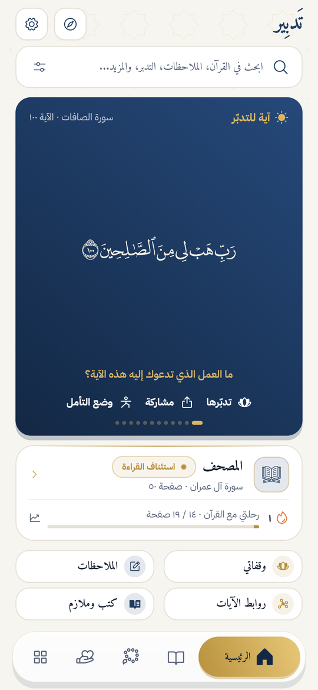
  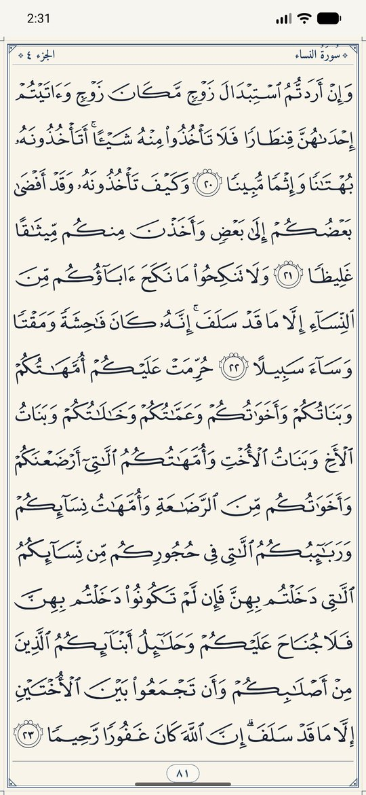
  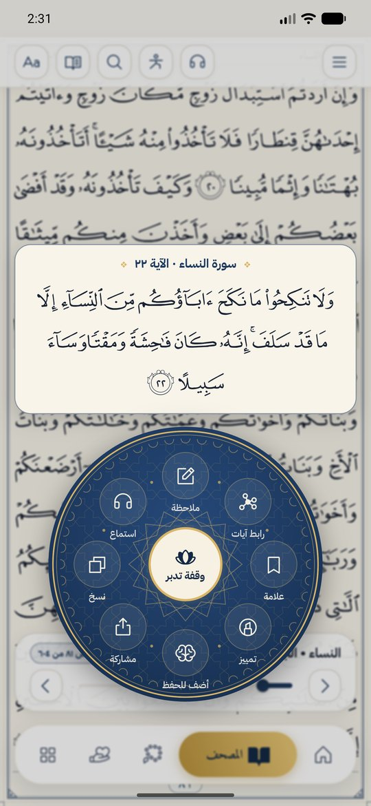
</p>

## Why Tadbeer?

The app helps you understand the Quran and act on it, not only read it. It is built around three tools:

- **Reflection pause:** four questions at any ayah that open its meanings.
- **Ayah links:** gather ayahs from different surahs into one theme and see them as a network.
- **Reflection pathways:** 15 themes, with an ayah and a question each day for at least seven days.

## Features

| Section | What it offers |
| --- | --- |
| **Mushaf** | 604 pages in the Madinah fonts or text fonts, smooth paging, a radial ayah menu and word meanings |
| **Listening** | 7 reciters, a whole surah or one ayah, and downloads for offline listening |
| **Journey** | Khatma plans, day streaks, goals, a Mushaf map and a monthly report |
| **Memorization** | Spaced review of the ayahs you memorize |
| **Duas** | Duas from the Quran, the Sunnah and the Ahlulbayt, with daily adhkar and counters |
| **Dhikr** | An istighfar and tasbeeh counter with auto counting |
| **Notes** | Notes on ayahs and a reflection journal, with export and save to device |
| **Library** | Books and booklets you read inside the app |
| **Themes** | Five app colors, with light, dark or automatic mode |
| **More** | Unified search, Qibla direction, reminders, a home-screen widget and encrypted backup |

The app explains itself with a first-launch tour, an animated guide for each section and a home screen walkthrough.

## App themes

Pick the look of the app on first launch, and change it any time in settings. Five colors restyle every screen, with light, dark or automatic mode that follows your phone.

<table>
  <tr>
    <td align="center" width="20%"><br><sub><b>Navy</b></sub></td>
    <td align="center" width="20%">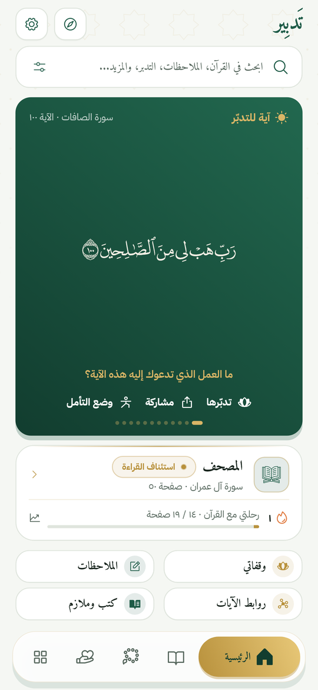<br><sub><b>Emerald</b></sub></td>
    <td align="center" width="20%">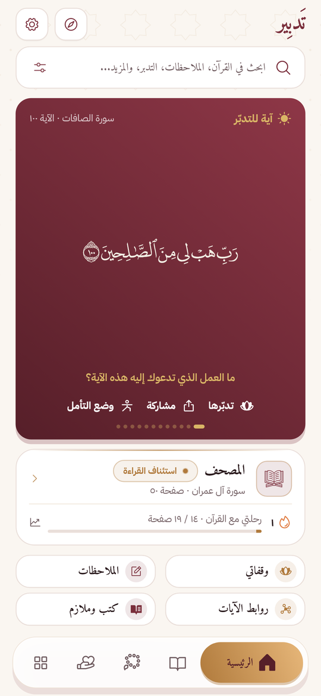<br><sub><b>Burgundy</b></sub></td>
    <td align="center" width="20%">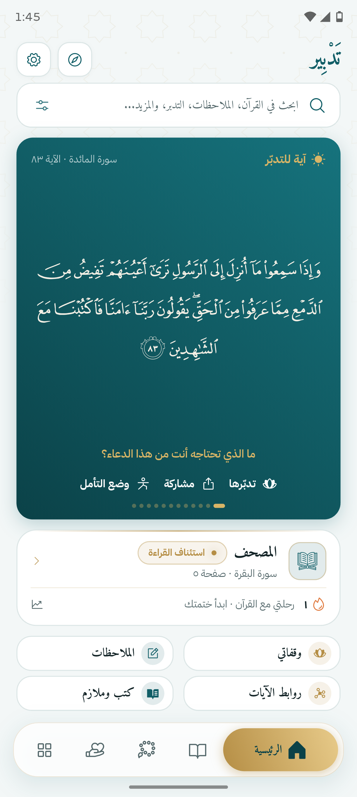<br><sub><b>Teal</b></sub></td>
    <td align="center" width="20%">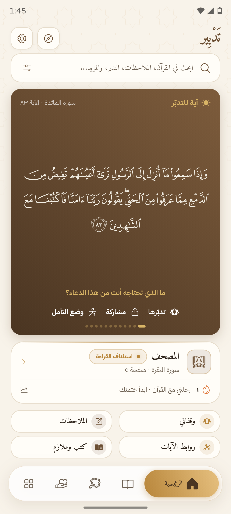<br><sub><b>Wood brown</b></sub></td>
  </tr>
</table>

## Screenshots

### Ayah links

<table>
  <tr>
    <td align="center" width="33%">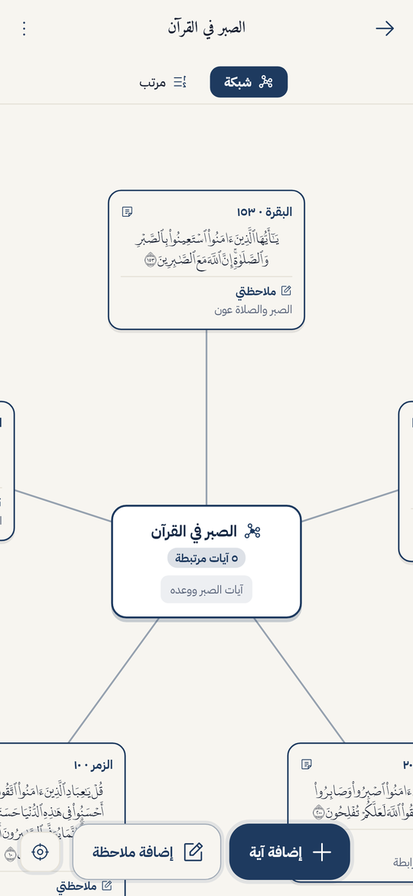<br><sub><b>Full network</b></sub></td>
    <td align="center" width="33%">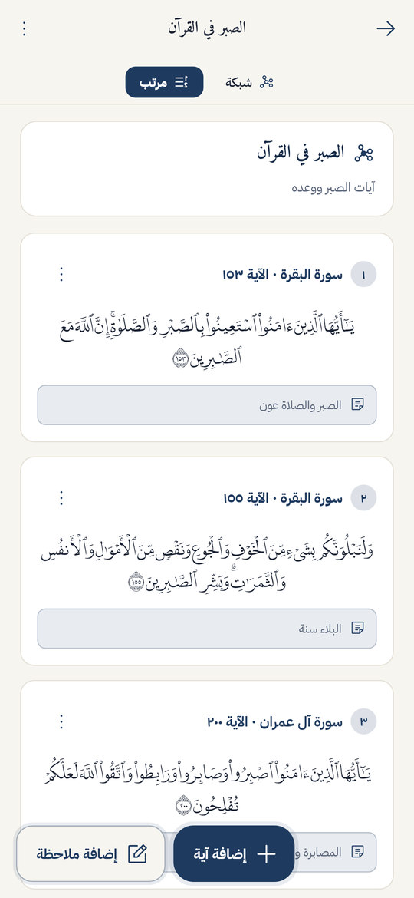<br><sub><b>Ordered view</b></sub></td>
    <td align="center" width="33%">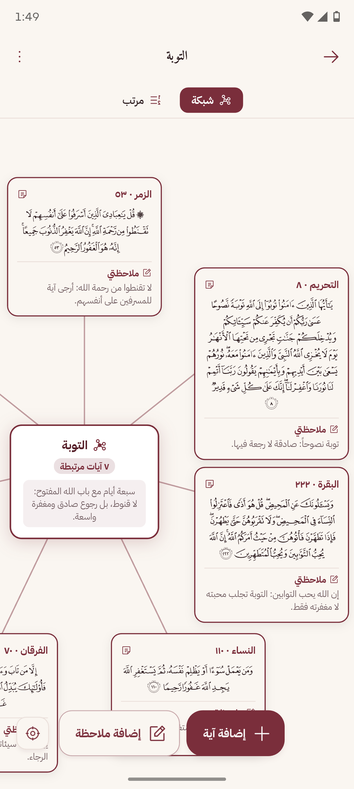<br><sub><b>Network details</b></sub></td>
  </tr>
</table>

### Your journey with the Quran

<table>
  <tr>
    <td align="center" width="50%">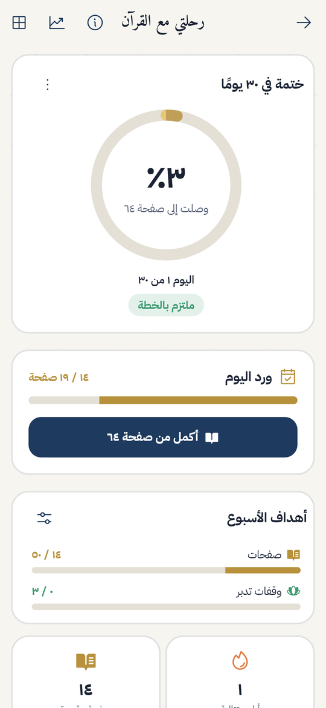<br><sub><b>Khatma plan</b></sub></td>
    <td align="center" width="50%">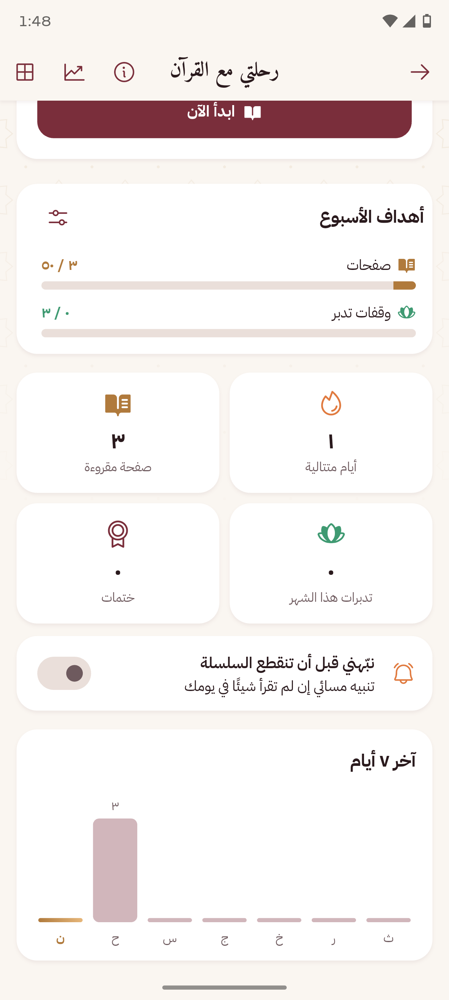<br><sub><b>Goals and stats</b></sub></td>
  </tr>
</table>

### Duas and dhikr

<table>
  <tr>
    <td align="center" width="25%">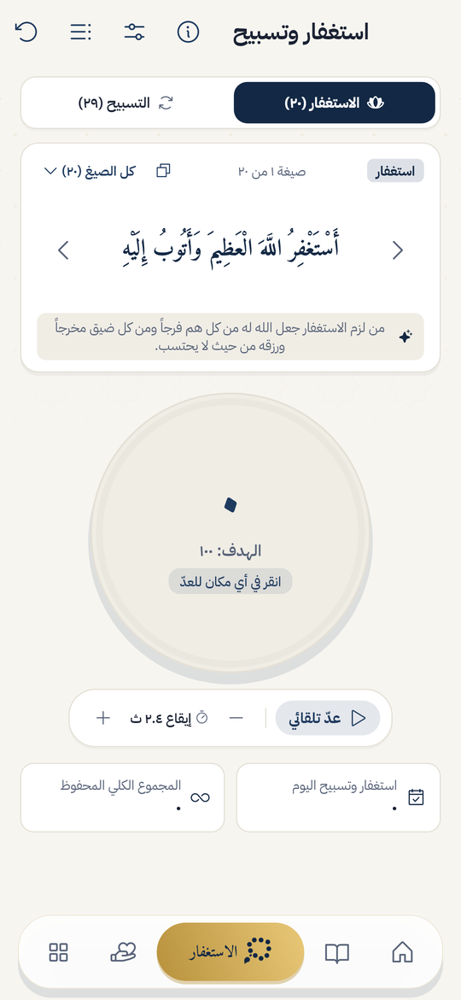<br><sub><b>Dhikr counter</b></sub></td>
    <td align="center" width="25%">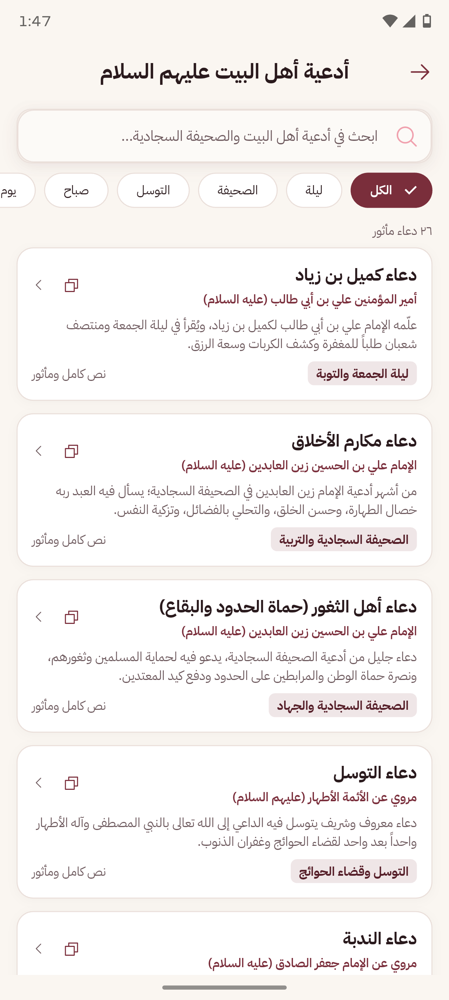<br><sub><b>Ahlulbayt duas</b></sub></td>
    <td align="center" width="25%">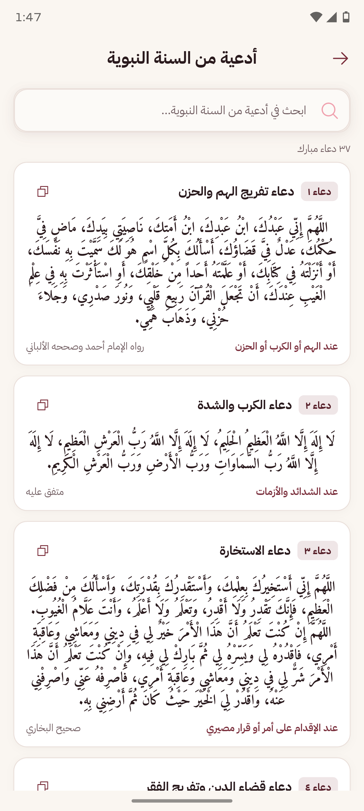<br><sub><b>Sunnah duas</b></sub></td>
    <td align="center" width="25%">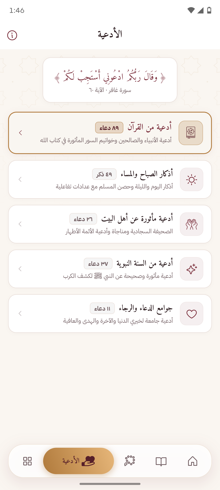<br><sub><b>Dua sections</b></sub></td>
  </tr>
</table>

### More

<table>
  <tr>
    <td align="center" width="33%">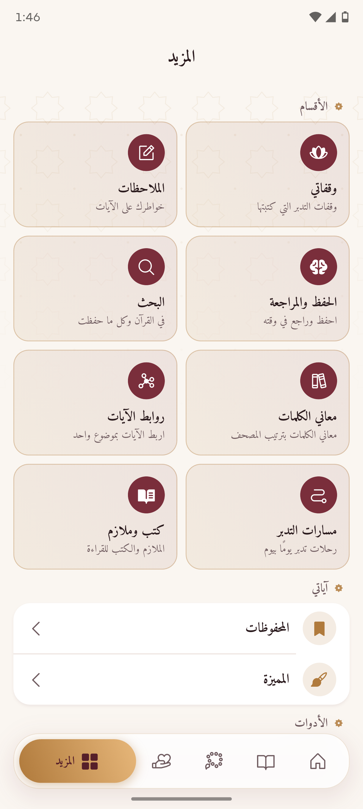<br><sub><b>All sections</b></sub></td>
    <td align="center" width="33%">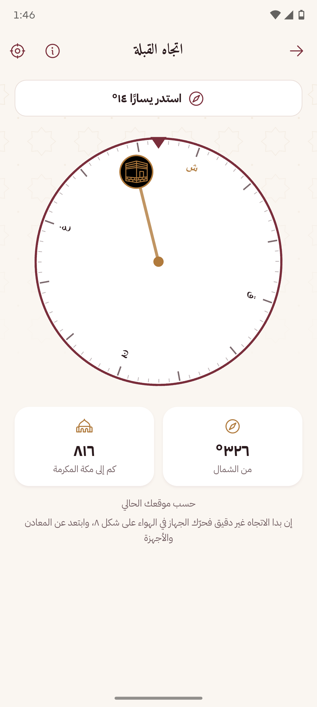<br><sub><b>Qibla direction</b></sub></td>
    <td align="center" width="33%">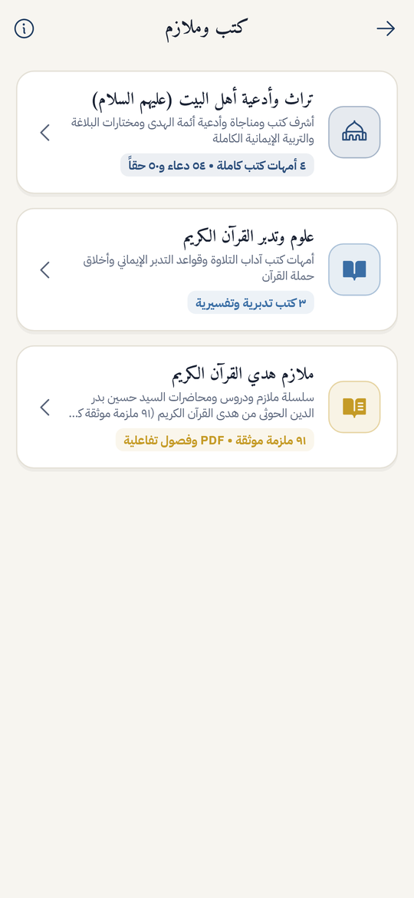<br><sub><b>Books and booklets</b></sub></td>
  </tr>
</table>

## Privacy

Your data stays on your device. No account, ads or analytics. The internet is used only for recitation, and approximate location only for the Qibla. See the [privacy policy](PRIVACY_POLICY.md).

## Getting started

You need Flutter 3.47.6 and the Android SDK. Full setup steps are in the [developer guide](DEVELOPMENT.md) (Arabic).

```bash
git clone https://github.com/Abdullah1x2x/Tadbeer.git
```

```bash
cd Tadbeer && flutter pub get && flutter run
```

```bash
flutter analyze && flutter test
```

## Documentation

- [Development Guide](DEVELOPMENT.md) (Arabic): architecture, environment setup, code standards and adding content.
- [Changelog](CHANGELOG.md): what changed in each release.
- [Privacy Policy](PRIVACY_POLICY.md): offline-first privacy and data safety.
- [Third-Party Notices & Licenses](THIRD_PARTY_NOTICES.md): full attributions for fonts and texts.

## Contributing

Fixes and ideas are welcome through [issues](https://github.com/Abdullah1x2x/Tadbeer/issues) and pull requests. If you find an error in a religious text, please report it first.

## License and sources

The app code is under the [MIT License](LICENSE). Bundled content has its own sources and terms:

- Quran text: [Tanzil Project](https://tanzil.net).
- Mushaf fonts: King Fahd Glorious Quran Printing Complex.
- Word meanings: [Quranpedia](https://quranpedia.net).
- Full details are in [THIRD_PARTY_NOTICES.md](THIRD_PARTY_NOTICES.md).
